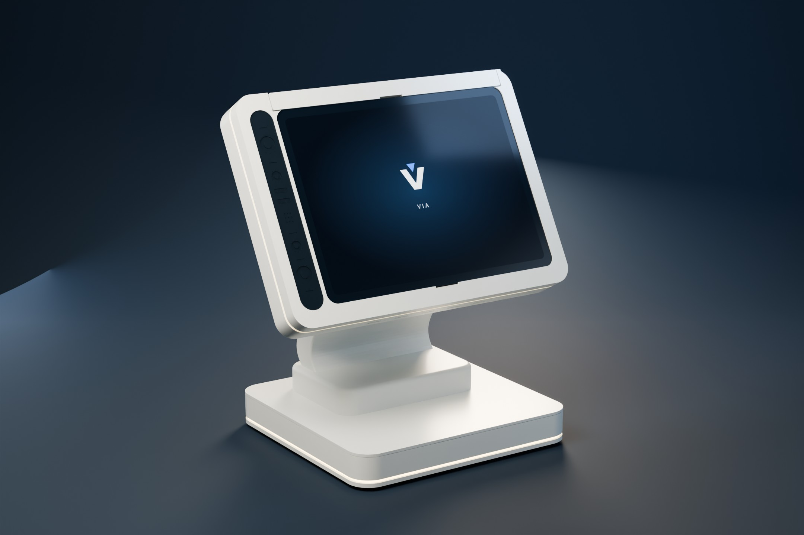
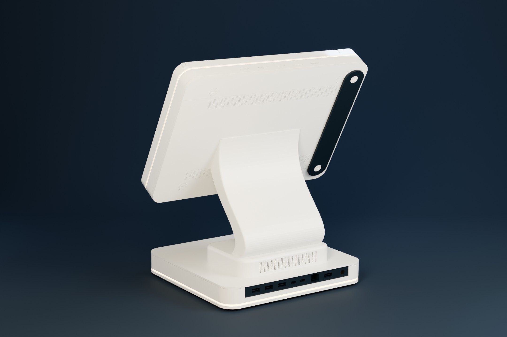
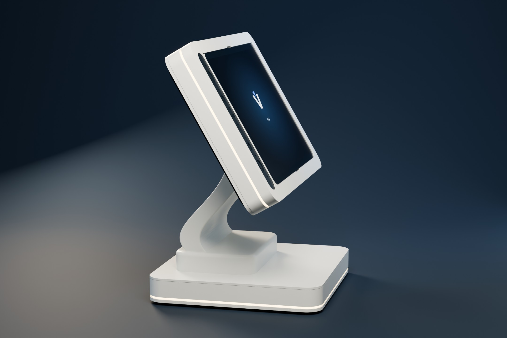
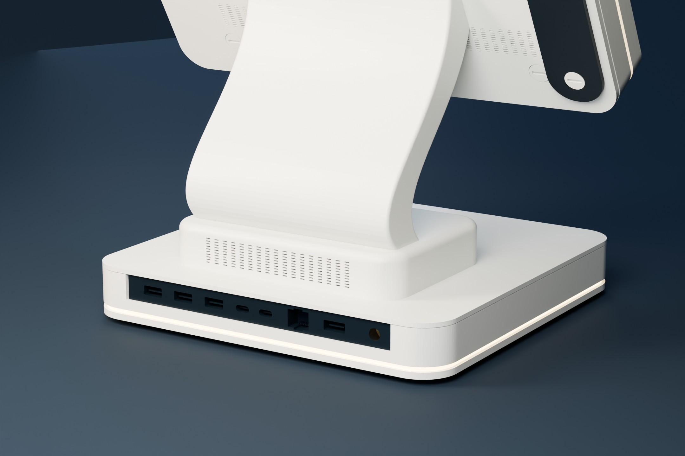

# VIA — OnePlus Pad Terminal Enclosure & Offline Android Demo

A **3D-printable OnePlus Pad OPD2203 kiosk enclosure** with a continuous S-shaped stand, integrated LED channels, serviceable tablet retention, printable fasteners, and two **offline Android applications: VIA Terminal and VIA Mobile**.

[](https://github.com/vluncasu/via-oneplus-pad-terminal/actions/workflows/quality.yml)


[Android apps](https://github.com/vluncasu/via-oneplus-pad-terminal/releases/tag/v1.0.5) · [Editable CAD / STEP / STL](https://github.com/vluncasu/via-oneplus-pad-terminal/releases/tag/r14.1-cad.3) · [Product gallery](docs/presentation-gallery.md) · [Build documentation](docs/README.md)



<p align="center">
  
  
</p>

*Assembled R14.1 geometry in a dedicated presentation studio. Finishes, lighting and static VIA screen artwork are staged for visualization.*

**Prototype publication, not a certified payment or biometric access system.** The CAD, print files, real-mesh renders, buildable source, test reports and design rationale are published together. The Android apps do not request the `INTERNET` permission; QR requests and signed Bluetooth LE responses operate locally. The application interface remains Romanian; this repository's documentation and part inventory are English.

## Start here

[Engineering documentation](docs/README.md) · [Illustrated handbook PDF](docs/VIA_Assembly_and_Demo_Handbook.pdf) · [Product studio gallery](docs/presentation-gallery.md) · [33-view engineering gallery](docs/gallery.md) · [Part catalog](docs/part-catalog.md) · [Demo runbook](docs/demo-runbook.md)

| Goal | Where to go |
|---|---|
| Install the latest Android apps | [GitHub release](https://github.com/vluncasu/via-oneplus-pad-terminal/releases/tag/v1.0.5) · [installation](docs/software.md) |
| Print the enclosure | [Color-separated STL files](hardware/print) · [printing guide](docs/printing.md) · [BOM](hardware/BOM.csv) |
| Edit the mechanical design | [Editable CAD — start here](hardware/cad) · [Direct editing guide](docs/editing-cad.md) |
| Inspect the normal assembled model | [Assembled Blender scene](media/via-oneplus-pad-r14-1-assembled.blend) |
| Assemble and service it | [Assembly sequence](docs/assembly.md) |
| Understand LED grooves and wiring | [LED integration](docs/led-and-wiring.md) |
| Read the academic design rationale | [Engineering design report](docs/design-rationale.md) · [PDF](docs/VIA_Engineering_Design_Report.pdf) |
| View product and internal renders | [Render gallery](docs/gallery.md) |
| Check exactly what was tested | [Verification status](docs/verification.md) · [machine-readable mesh audit](hardware/validation/print-mesh-audit.json) |

## What's included

- One-piece base body, one-piece integrated S stand/power-supply cover, removable bottom cover, structural front frame, rear service covers and sliding tablet retention bar.
- Integrated head and base LED channels for an **8 mm strip with a nominal 8.5 mm reserved width**. The visible light belt is approximately 3 mm; it is not the LED PCB width.
- Recessed, nonfunctional USB/Ethernet-style dummy port cartridge; detailed black decorative sensor face and serviceable USB-C cable access.
- **30 required printed components from 17 unique required STL files**, plus 15 optional calibration/test files. Quantity is encoded in each filename. No prearranged plates or printer-specific G-code are supplied.
- R14 CAD plus the later **O05 0.20 mm single-layer optical-film amendment**; the 0.40 mm alternative remains available and clearly identified.
- VIA Terminal and VIA Mobile 1.0.5 source; named local profiles, local QR/BLE confirmation, Bluetooth recovery and proper Mobile Back navigation.
- Optional ESP32 LED-control firmware; it is independent of tablet–phone confirmation.

## Modify the enclosure

[Download the editable CAD / STEP / STL handoff](https://github.com/vluncasu/via-oneplus-pad-terminal/releases/tag/r14.1-cad.3)

Open the [clean FreeCAD assembly](hardware/cad/native/VIA_Terminal_R14_1_Editable.FCStd), the [complete assembly STEP](hardware/cad/assembly/VIA_Terminal_R14_1_Assembly.step), or an [individual component STEP](hardware/cad/step). The [editing guide](docs/editing-cad.md) explains direct solid editing and export back to printing. Native CAD contains final editable solids, without requiring a construction macro.

## Expanded documentation downloads

The [expanded illustrated edition](https://github.com/vluncasu/via-oneplus-pad-terminal/releases/tag/r14.1-docs.2) contains the 33-view gallery and 28-page assembly/demo handbook. APKs remain in the 1.0.5 application release above. See the [documentation changelog](docs/documentation-changelog.md) for the exact scope.

## Integrated details



[Full-resolution presentation images and editable studio](docs/presentation-gallery.md) · [Internal structure and assembly views](docs/gallery-engineering.md)

Inspect the [open head assembly](media/renders/20-open-head-tablet-seating.png) and [separate port cartridge](media/renders/25-dummy-ports-front-detail.png) in the engineering views.

The [engineering gallery](docs/gallery-engineering.md) explains omitted covers, reference volumes and section cuts. Follow the [manufacturing workflow](docs/manufacturing-workflow.md), [fastener map](docs/fasteners-and-service.md) and [acceptance plan](docs/acceptance-test-plan.md) to move from CAD to a recorded physical build.

## Hardware envelope

| Item | Reference / design value |
|---|---|
| Target tablet | OnePlus Pad OPD2203; nominal body 258.03 × 189.41 × 6.54 mm |
| R14 head | Approximately 310 × 224 × 33.3 mm in its local frame; do not substitute the early 290 mm concept width |
| Base | Nominal 240 × 230 mm footprint |
| Display plane | Nominal 60° to the desk |
| Tablet pocket gauges | 259.03 mm and 190.41 mm; actual fit still needs measurement |
| Printer reference | Bambu Lab P1S, nominal 256 × 256 × 256 mm; slicer exclusions, brim and supports still matter |
| Optical-film default | O05: 25.6 × 193.6 × 0.20 mm, one 0.20 mm layer |

Manufacturer sources and measurement limitations are listed in the [references](docs/references.md). The supplied print orientations fit a nominal bounding box; this is not proof of support-free printing, strength, thermal performance or physical tablet fit.

## Ten-minute demo

Install both apps, enable Bluetooth and allow Camera / Nearby devices. On the tablet choose a payment demonstration or a validation service. Scan its QR using VIA Mobile. The phone automatically sends a signed response over BLE; the tablet validates the response before displaying the demo result. No reverse camera scan, external backend or internet is required. Named profiles can be enrolled locally through face → smile → palm; landmark comparison remains experimental.

## Build

```bash
cd android
# Install JDK 21 and Android SDK platform 36 first.
# Set ANDROID_HOME or create your own untracked local.properties.
bash ./gradlew :app-terminal:assembleDebug :app-mobile:assembleDebug
```

Use the [complete build and test instructions](docs/software.md). Downloaded official release APKs preserve the existing demo signing identity; independently built APKs may use a different debug key.

## Project status and rights

The design is a prototype. Physical load, creep, touch stability, LED temperatures, optical uniformity, camera performance and Bluetooth interoperability require real-device tests. Decorative ports and lenses are not functional connectors or stereo cameras. Electronics, cables and the tablet are real components, not printable substitutes.

This is a publicly viewable source/CAD publication. No blanket open-source license is assumed; see [rights and third-party notices](LICENSE.md). OnePlus, Bambu Lab and Android are third-party trademarks; this is an independent project.
