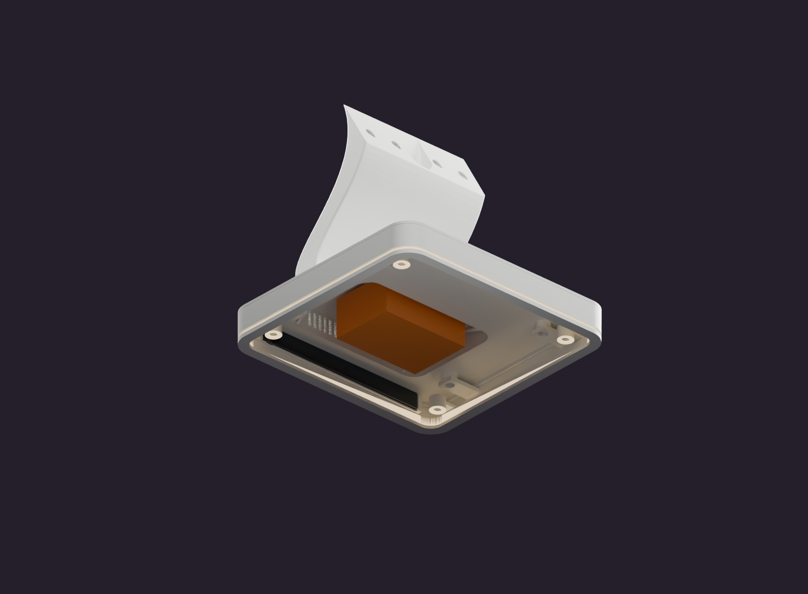
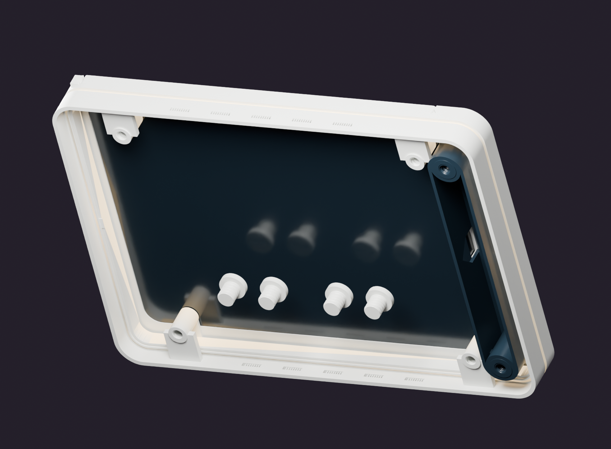
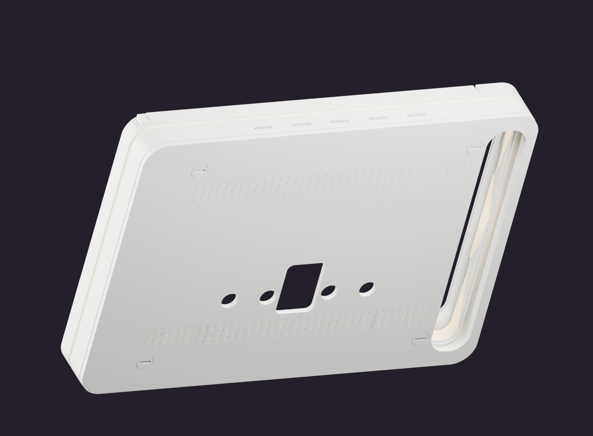

# Assembly and Service Instructions

Use the [BOM](../hardware/BOM.csv) and part IDs. Interior markings are intended for identification; verify that any printed marking is readable before finishing. Reference envelopes R01–R05 are not printable components.

## Assembly map

[Identify parts](part-catalog.md) → [qualify probes](manufacturing-workflow.md) → build base/stand → route leads → mount head → fit optical parts/tablet → close service covers → [acceptance checks](acceptance-test-plan.md). Keep the underside open until leads and cartridge are installed.

Figure 22 omits B03; orange is the provisional R02 body envelope, not a selected electrical installation.

## Dry assembly order

1. Print the relevant fit, connector, thread and LED coupons. Confirm the actual OPD2203 dimensions, front-camera position, USB-C plug body, rear protrusion and chosen supply.
2. Inspect and clean B01/B03/B07; check that the stand duct is continuous and contains no support remnants or infill. Pull the Q12 gauge, then the actual unpowered connector/cable, through the complete route.
3. Insert P01 from the service side into the recessed base opening. The port face should remain within the base's exterior envelope; do not force a protruding cartridge or insert real plugs into the dummy cavities.
4. Trial the chosen power module against its actual mounting/clearance needs. Keep the S-root braces intact. Install low-voltage wiring and strain relief so the service cover cannot pinch the cable. The reference supply is only an envelope, not a validated mains installation.
5. Seat the B07 integrated upper cover/stand in B01, checking the perimeter alignment and retained cable route. Use the designed underside-access fastening arrangement; do not drill new holes through visible top faces to compensate for poor fit. Printed threads require calibrated coupons and gentle hand tightening.
6. Attach the head at its matched stand interface using V21–V24, retaining internal wire routing. Confirm the joint bears on its intended structural faces rather than on a cable or cosmetic edge.
7. Install and test the LED strips as described in [LED and wiring](led-and-wiring.md). Do this before final closure; do not route the corner feed through a screw seat.
8. Fit the side cassette from the service side: O05 film against the integrated H01 shoulder, O06 decorative face, O01 open carrier, then O03 USB service cover with V61/V62. Verify captive retention from both front and back. The thinner 0.20 mm film needs a fit test; it is not adhesively bonded over the tablet screen.
9. Support the tablet and slide its body into the head. Keep the real front camera clear. Connect USB-C through the optical/service region; the entire charger is not housed in the sensor bar.
10. Install H04, then H05 in its top guides. Fit H06 fully so its integrated pins enter the bar's blind receivers and the tablet stops seat properly. Fasten the rear covers with V51–V54 as appropriate; do not use a screw to pull a misaligned cover into place.
11. Close B03 using V41–V44. Fit the four V31–V34 spherical screw feet, keeping their driver slots accessible. Check desk contact and sliding stability.
12. Verify charging, camera view, lighting and the software demonstration while monitoring temperature. Finish and paint only after successful repeated dry assembly.

## Inspect the tablet and retention interfaces

Figure 20 retains the nominal tablet body and H05, omitting rear covers for inspection.

Figure 21 removes the tablet and optical cassette. Use the [interface guide](interfaces-and-retention.md) to distinguish guides, locking pins and screw retention.

## Remove the tablet through the upper rear opening

- Support the head on a padded surface and support the tablet throughout removal.
- Open O03 and disconnect USB-C from the tablet.
- Undo the two upper rear screws V52 and V54.
- Withdraw H06 rearward, freeing its integrated pins from H05 and retracting the upper tablet stops.
- Slide H05 upward in the screen plane and out of its guides. Do not pry it toward the glass.
- Support the tablet edge through the upper rear opening and lift the tablet out.

Reassembly reverses the sequence. The guide pins lock the bar's lift path; they are neither springs nor substitute screws. The archived service sweep excludes real cable bending, buttons and camera protrusions.

## Acceptance checks

The port cartridge must not project from the base; neither the optical face nor the film may fall forward; the stand root must not rock; screws must seat without stripping; no wire may cross the tablet extraction path; and service covers must close without loading the glass. Inspect again after a warm closed-enclosure test. No tightening torque or structural capacity has been experimentally established.

## Screw and inspection references

Use the [fastener map](fasteners-and-service.md) to select the receiving interface and correct length. The [troubleshooting guide](troubleshooting.md) covers proud screws, loose cartridges and a blocked sliding bar. Complete the [acceptance record](acceptance-test-plan.md) before the powered demonstration.
