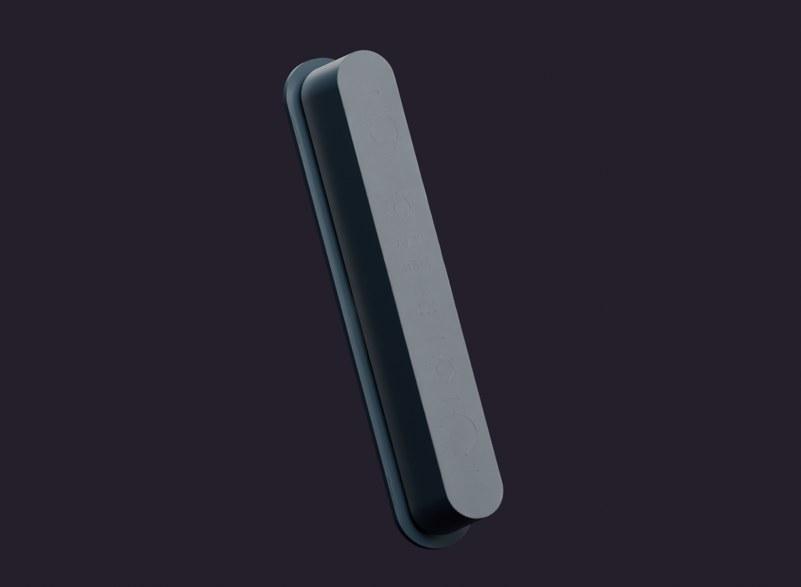
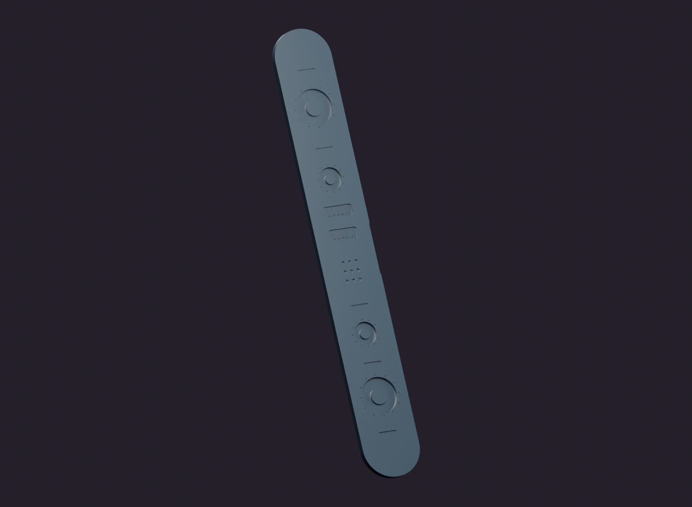
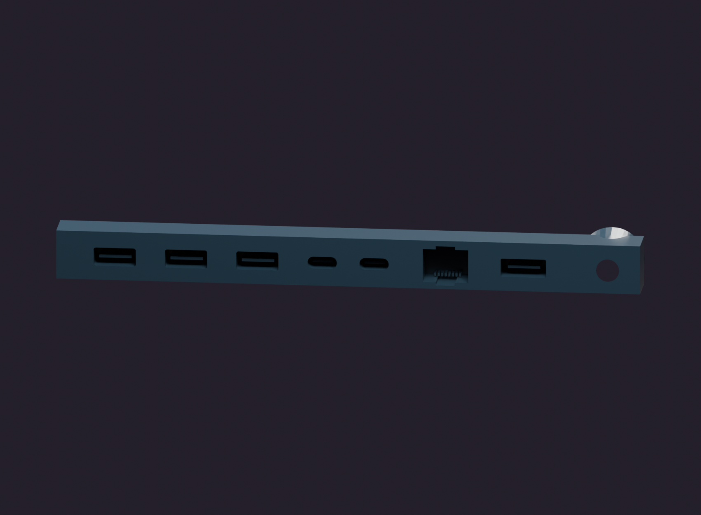
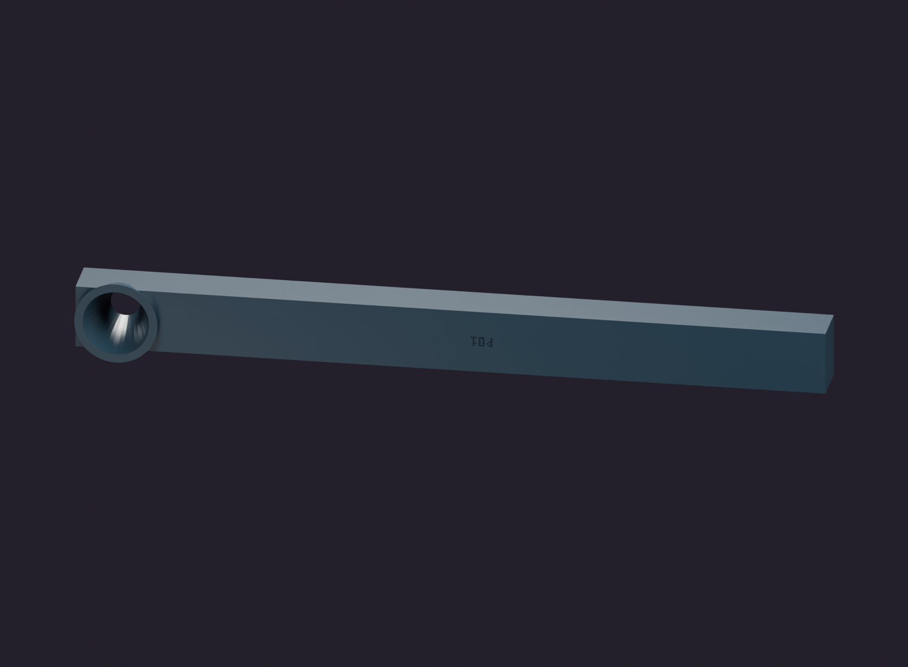
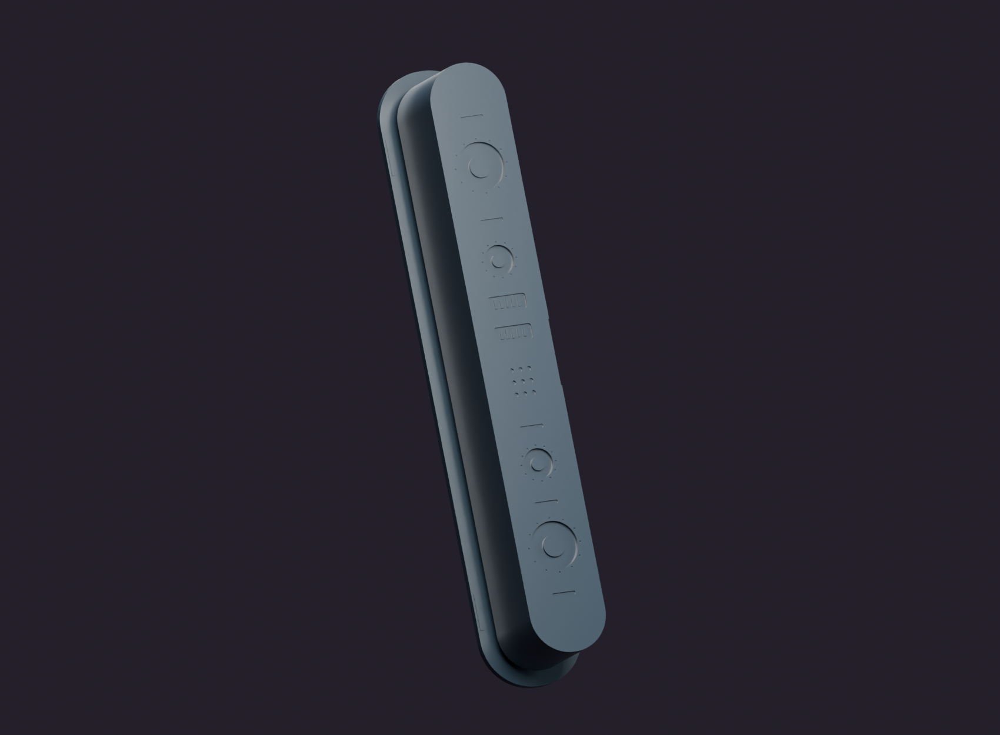
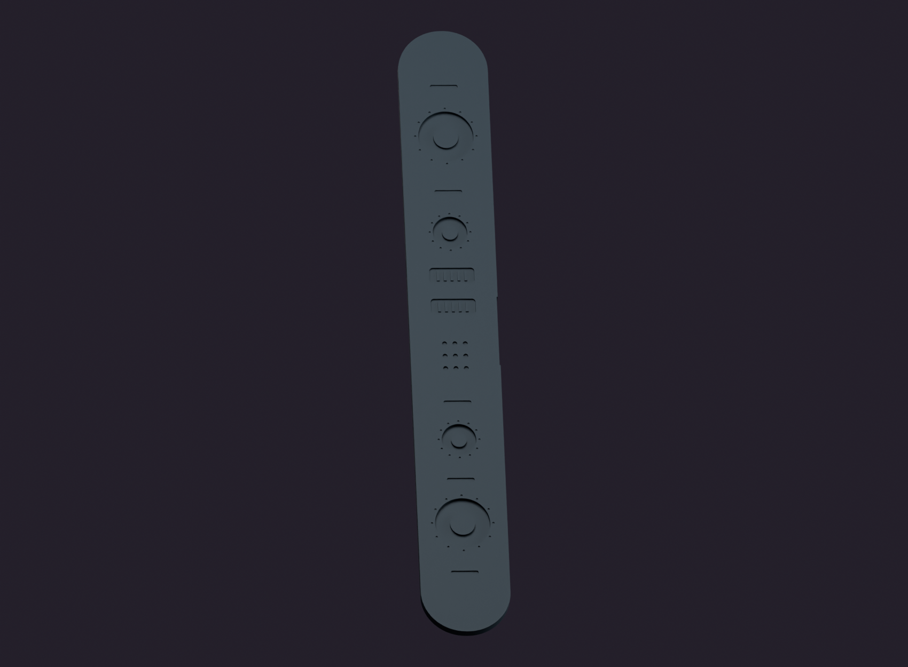

# Printable Components and Decorative Details

All figures use the supplied actual component meshes. Materials and intended LED emission are illustrative. Orange objects are non-printable reference envelopes. Covers omitted and section cuts are stated per figure; they do not alter the STL files. The normal [assembled Blender scene](../media/via-oneplus-pad-r14-1-assembled.blend) remains separate.

[Gallery index](gallery.md) · [Documentation](README.md)

## Figure 05 — Optical cassette with captive film

O01/O03/O05/O06 in assembly coordinates. Film transmission is illustrative, not measured PETG clarity.

## Figure 11 — Flat-backed decorative sensor face

O06 black printed face with sensor-like relief; no real stereo camera or additional sensors are implied.

## Figure 12 — D12 printed head-mount screw

Representative V21-family screw, slotted head and coarse printed thread.

## Figure 13 — Spherical slotted screw foot

Representative V31-family rigid printed foot, including the accessible driver slot.

## Figure 25 — Dummy port cartridge from the front

P01 is one black printed component. Tongues and recesses are decorative; do not use them as real sockets.

## Figure 26 — Port cartridge from the service side

Reverse view of P01 and its incoming-cable funnel. A printed funnel is not a certified strain-relief gland.

## Figure 27 — Optical detail with film omitted

O01/O06/O03 and USB service screws. O05 is intentionally omitted so the printed sensor relief can be inspected.

## Figure 28 — Optical USB service side

O01/O03, service screws and orange R03 provisional right-angle USB body. Decorative face and film omitted.

## Figure 33 — Decorative sensor face in raking light

Low-angle illumination emphasizes the real relief of O06. Layer resolution must be verified in the chosen 0.4 mm nozzle profile.
