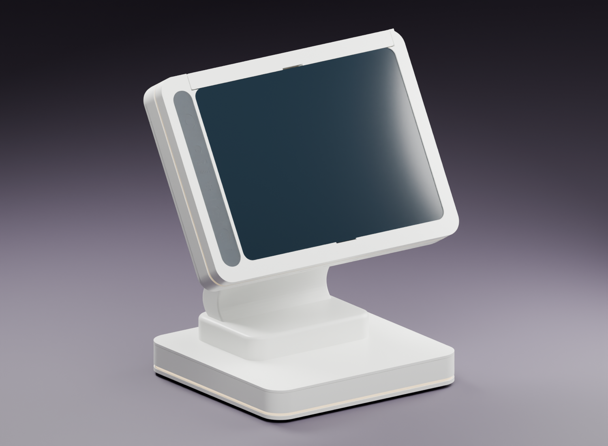
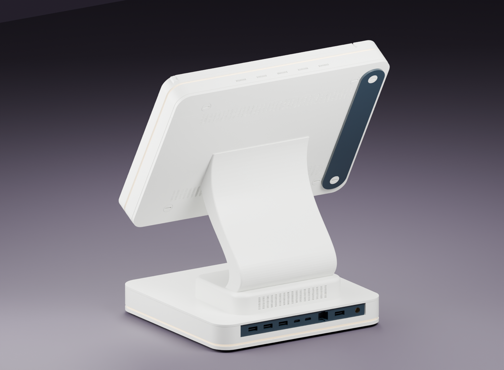
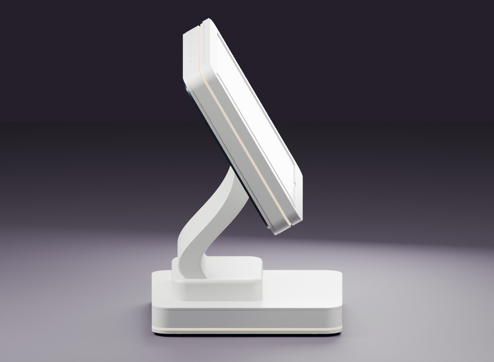
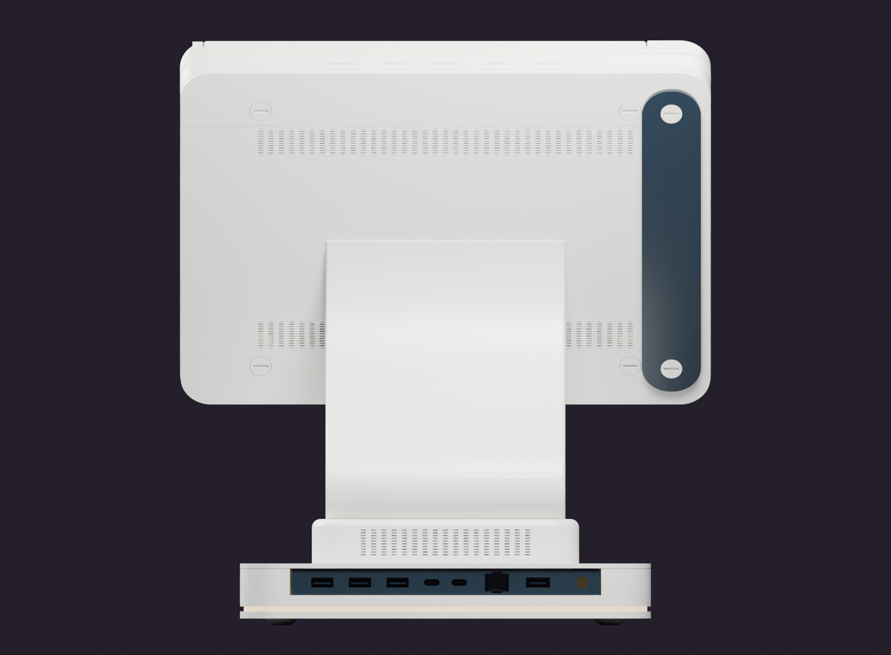
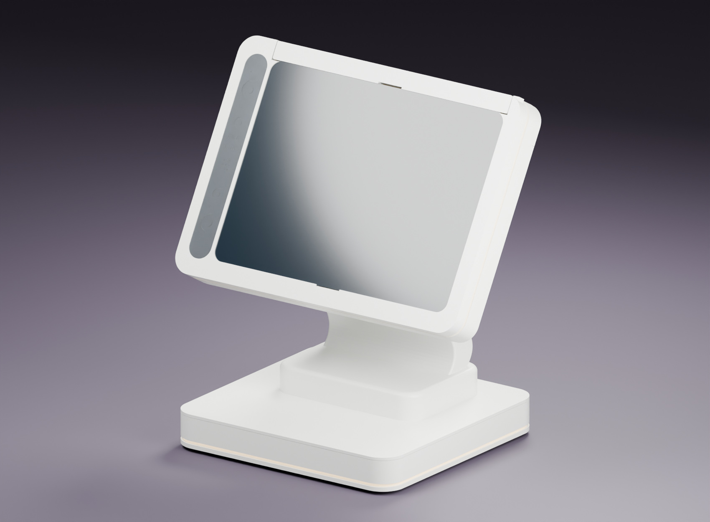
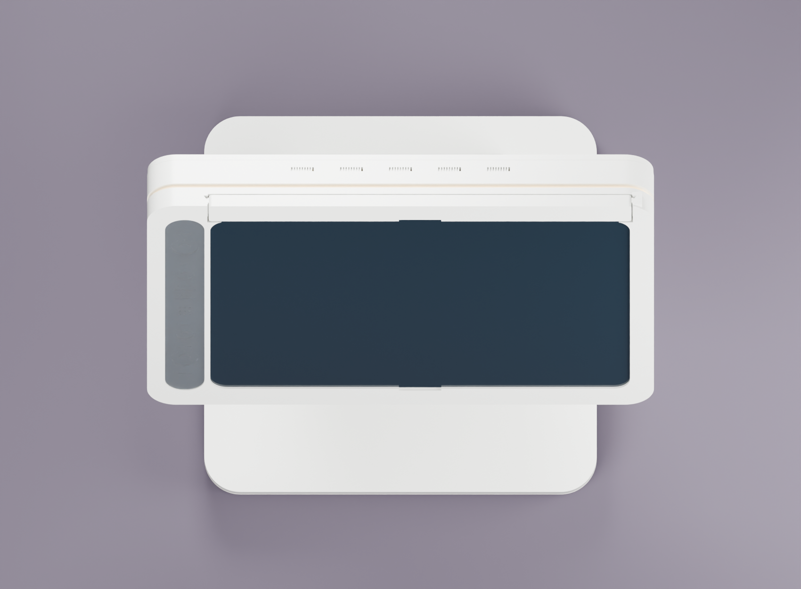
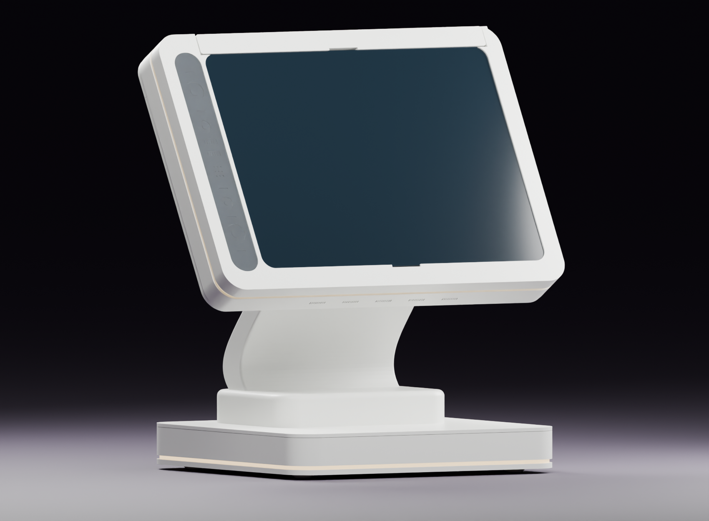
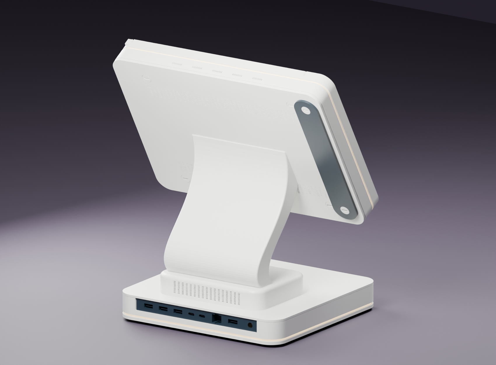

# Product Views and Orthographic Elevations

All figures use the supplied actual component meshes. Materials and intended LED emission are illustrative. Orange objects are non-printable reference envelopes. Covers omitted and section cuts are stated per figure; they do not alter the STL files. The normal [assembled Blender scene](../media/via-oneplus-pad-r14-1-assembled.blend) remains separate.

[Gallery index](gallery.md) · [Documentation](README.md)

## Figure 01 — Front three-quarter overview

Normal assembled terminal: original tablet front, white structure, one-piece S stand and intended light belts.

## Figure 02 — Rear three-quarter overview

Normal assembled terminal: rear service surfaces and recessed black dummy port cartridge.

## Figure 03 — Side silhouette

Continuous B07 stand and upper power-volume cover in the assembled terminal.

## Figure 14 — Front orthographic elevation

Assembled front-facing orthographic view. No dimensions should be measured from perspective product figures.

## Figure 15 — Rear orthographic elevation

Rear elevation showing the arrangement of vents, service covers, side cassette and recessed ports.

## Figure 16 — Opposite front three-quarter

Additional viewing side of the assembled product, without an exploded presentation.

## Figure 17 — Overhead product view

Top projection of the normal assembly and footprint relationship. Ground-plane shadows are illustrative.

## Figure 18 — Low-angle light-belt view

Low front product angle. Emissive materials communicate the target luminous zones, not tested brightness or opacity.

## Figure 19 — Opposite rear three-quarter

Alternate rear product view showing the stand/head relationship and service surfaces.
