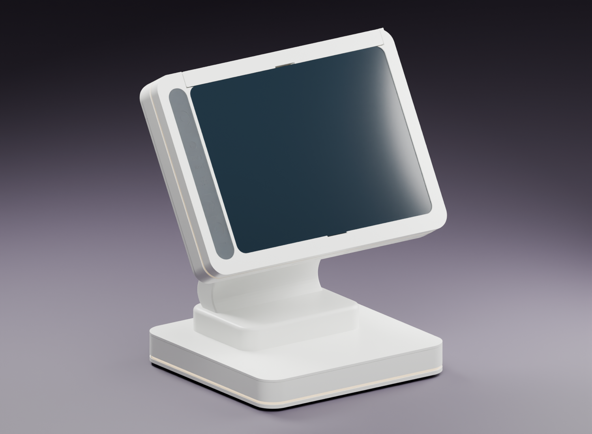
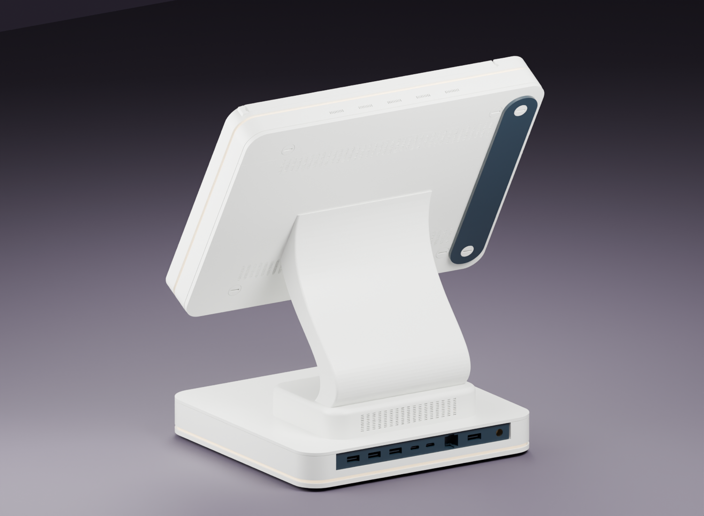
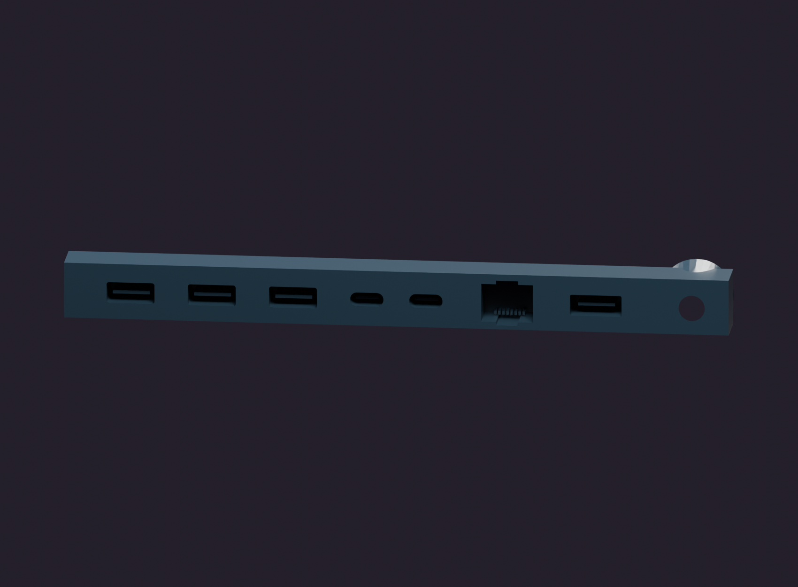

# VIA OnePlus Pad Terminal — Illustrated Gallery

[New product presentation gallery](presentation-gallery.md): four studio views with static VIA branding, revised lighting and full-resolution downloads. The 33 engineering figures below retain their original figure IDs.

**33 real-mesh renderings**, including 20 additional product, service and component views. All figures use the supplied actual component meshes. Materials and intended LED emission are illustrative. Orange objects are non-printable reference envelopes. Covers omitted and section cuts are stated per figure; they do not alter the STL files. The normal [assembled Blender scene](../media/via-oneplus-pad-r14-1-assembled.blend) remains separate.

## Browse by purpose

| Gallery | What it explains |
|---|---|
| [Product views](gallery-product.md) | Normal assembled terminal, front/rear elevations, overhead and alternate angles |
| [Structure and service](gallery-engineering.md) | LED grooves, stand-root reinforcement, cable duct, tablet seating and covers |
| [Components](gallery-components.md) | Dummy port interiors, optical carrier, sensor detail and printed fasteners |

## Selected views

### Figure 01 — Front three-quarter overview

Normal assembled terminal: original tablet front, white structure, one-piece S stand and intended light belts.

### Figure 02 — Rear three-quarter overview

Normal assembled terminal: rear service surfaces and recessed black dummy port cartridge.

### Figure 07 — Integrated head LED channel

H01 with R05 orange reserved LED volume. The orange object is not a printable strip or a verified bend solution.

### Figure 20 — Head with rear covers omitted

H01, nominal R01 tablet envelope, optical parts, H05 and head screws remain. H04/H06 omitted for seating inspection.

### Figure 22 — Base underside and supply envelope

B01/B07/P01 with orange R02 body envelope; bottom service cover omitted. R02 is not a detailed supply or a clearance qualification.

### Figure 25 — Dummy port cartridge from the front

P01 is one black printed component. Tongues and recesses are decorative; do not use them as real sockets.

## Use the figures correctly

Use product views for appearance, cover-omitted views for assembly relationships and sections for internal voids. An orange envelope shows reserved space, not a purchased component that has been measured to fit. LED line appearance in a render is not an optical test. Read [interfaces and retention](interfaces-and-retention.md), [LED integration](led-and-wiring.md) and the [physical test plan](acceptance-test-plan.md) before fabrication.

Open the [normal assembled Blender scene](../media/via-oneplus-pad-r14-1-assembled.blend) to inspect objects or change cameras, lights and materials directly.
