# OnePlus Pad Terminal — Render Gallery

These views are generated from supplied part meshes, not AI concept images. Materials, emission and translucency illustrate design intent; they are not measured optical or mechanical performance. The background is a custom deep-plum architectural studio. The normal assembled Blender scene is supplied separately.

## Assembled terminal

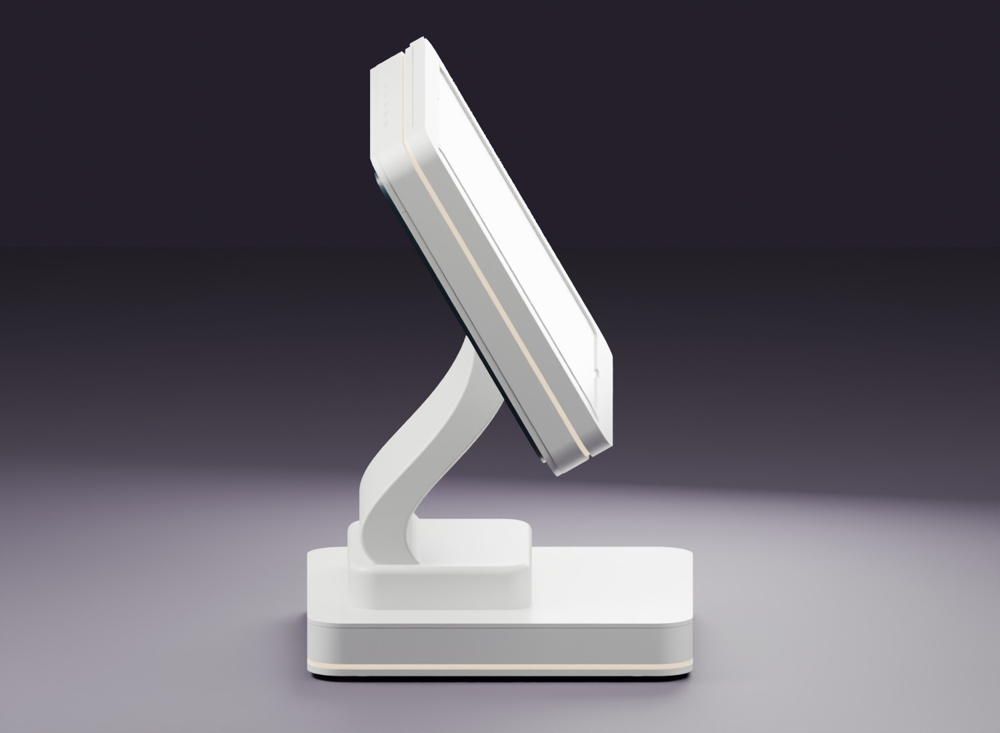

## Serviceable details

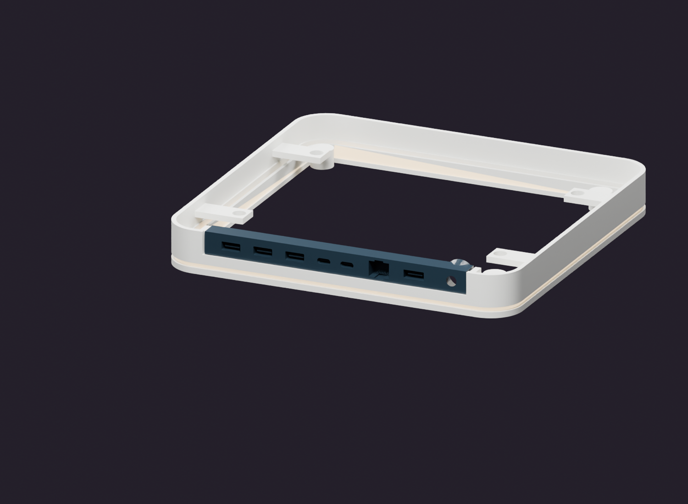

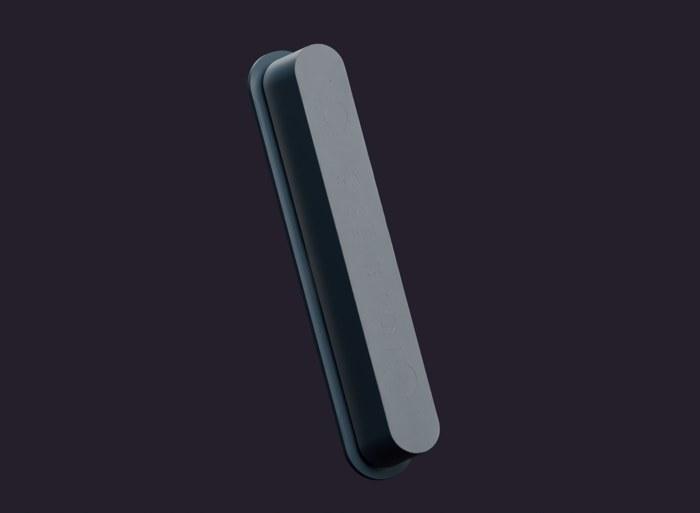

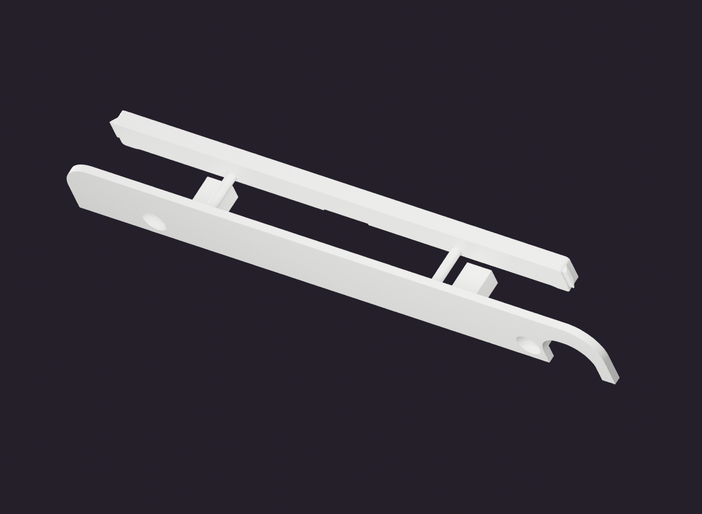

## Real internal geometry

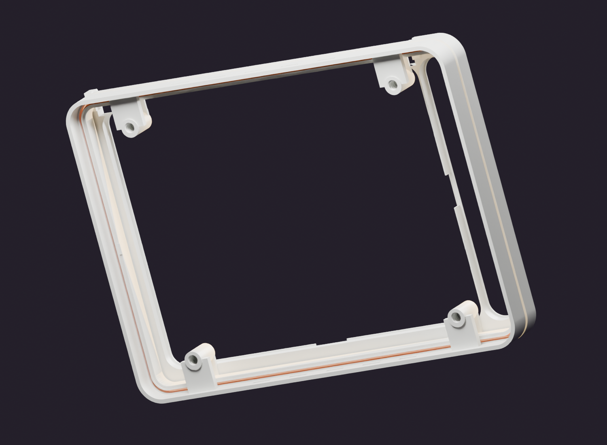

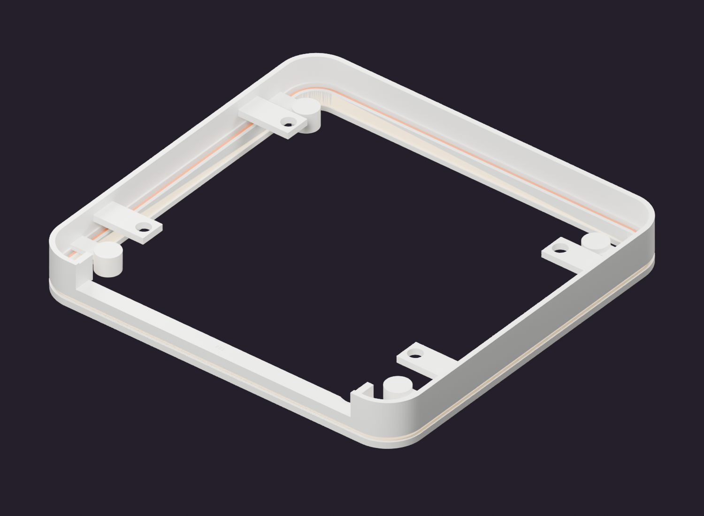

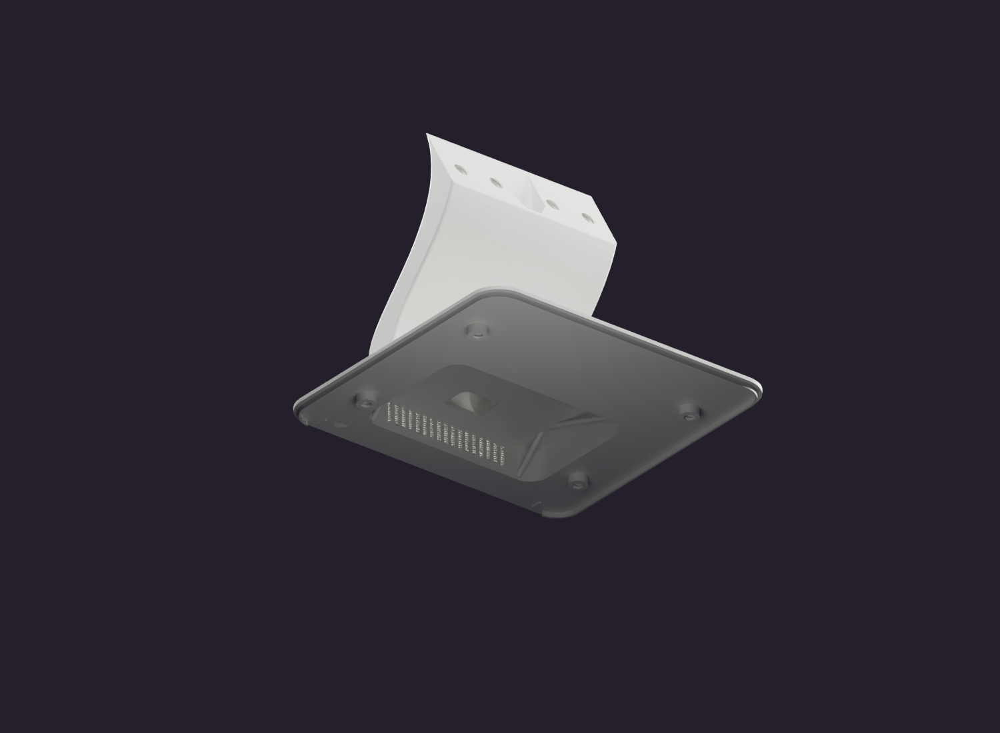

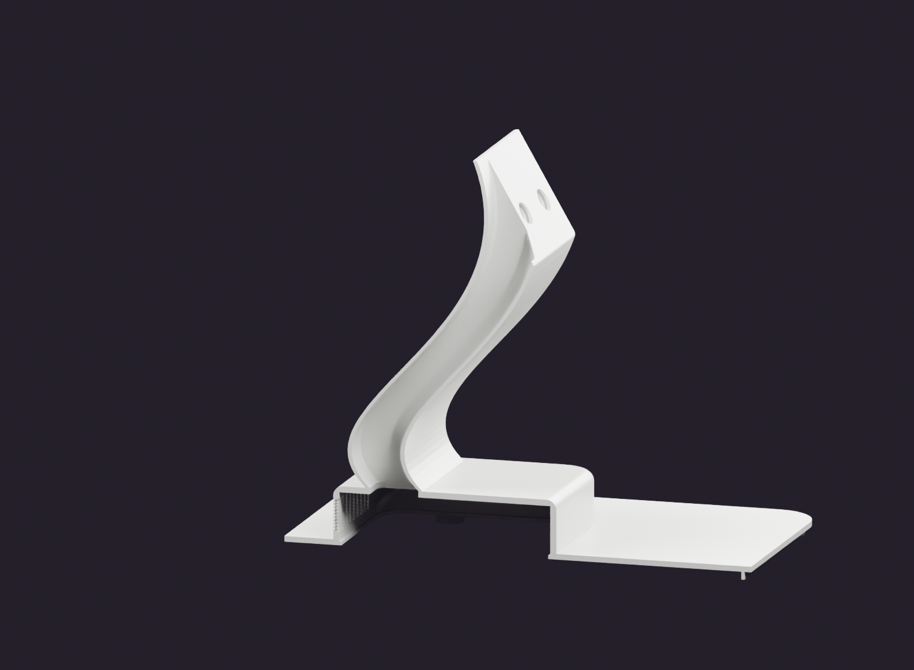

Orange solids in channel views are reference keep-out envelopes. The section view removes part of the stand for inspection; the printable B07 file remains a monoblock part.

## Printable detail parts

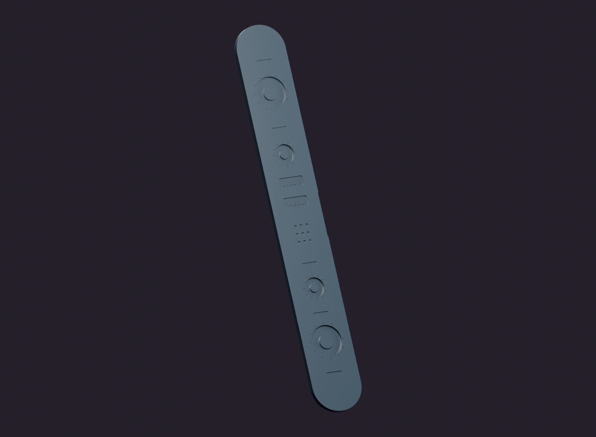

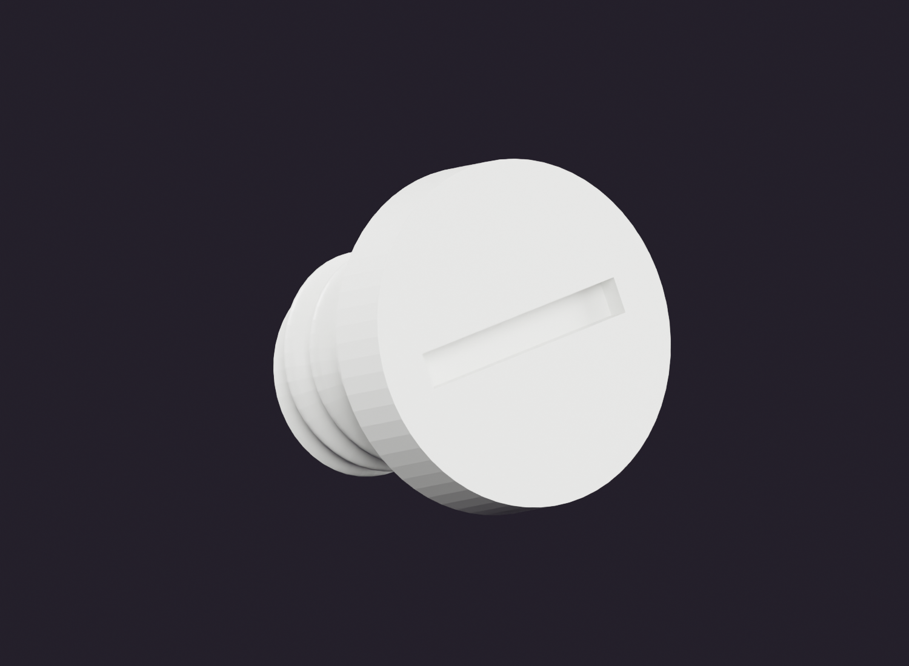

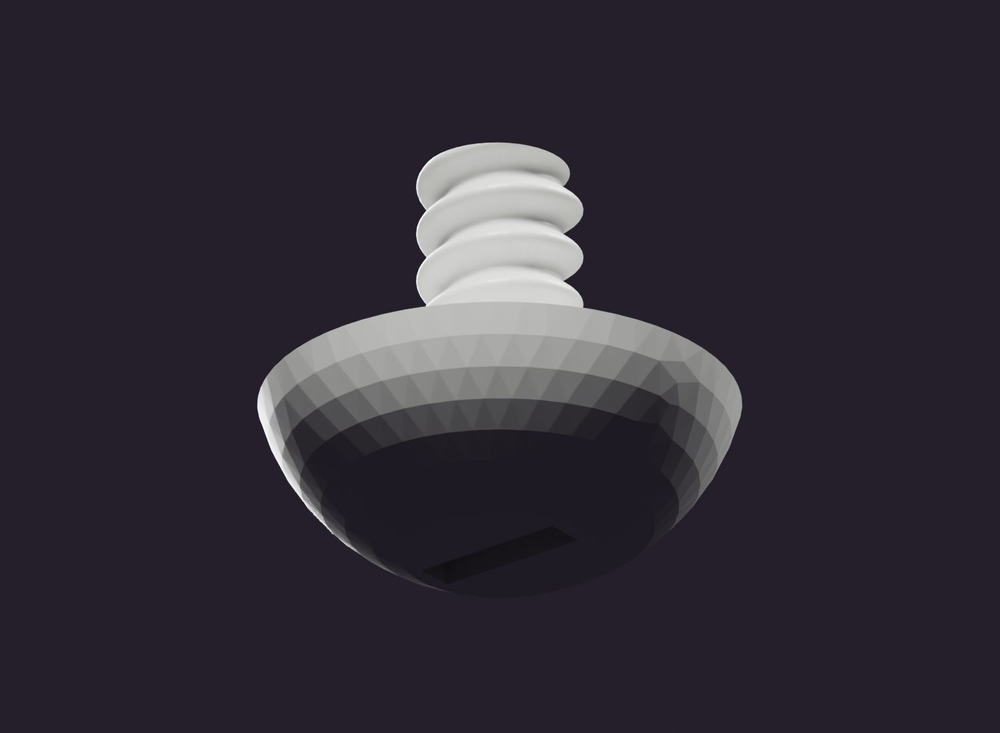
