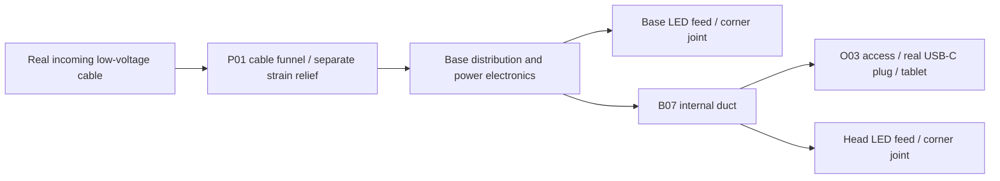
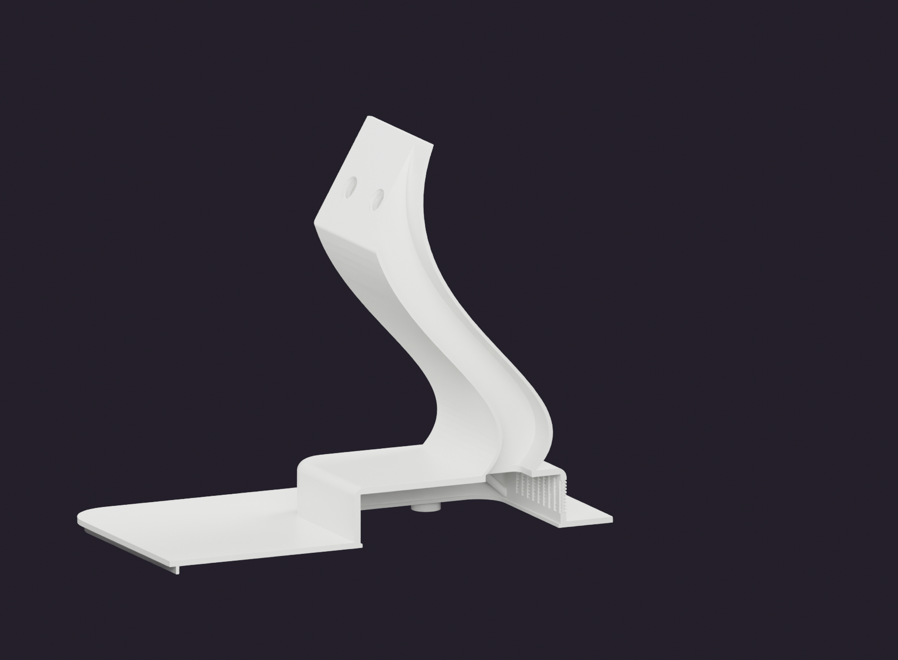

# Integrated LED Channels, Optical Belts and Internal Wiring

## Dimensions are different functions

| Feature | Nominal design intent |
|---|---|
| Strip PCB width | 8 mm |
| Reserved seating width / reference | 8.5 mm, including 0.5 mm total nominal allowance |
| Visible luminous belt | Approximately 3 mm |
| O05 optical film | 0.20 mm default; unrelated to the tablet display glass |
| Stand cable route | Approximately 30 mm wide × 24 mm central height, with a shaped roof |
| Connector test body | 16 × 10 × 30 mm provisional body, Q12 |

H01 and B01 contain the head/base channel and light-belt geometry. Their integrated shielding/rim geometry is part of those same printed structures. There are no separate L1/L2 black channel pieces to print in the current inventory. A one-material white shell still needs physical testing for light leakage; geometry and opacity are different properties.

## Installation sequence

1. Use Q15 to test the actual LED strip at a complete corner. Check PCB width, component height, adhesive thickness, cut points, bend direction and connector/solder bulk. Do not assume a flat strip can bend edgewise around the rounded perimeter.
2. Feed the strip through the open service side and seat it against the defined perimeter carrier. The reference envelopes R04/R05 show reserved volume; they are not printed strips or proof of insertion feasibility.
3. Position a feed/corner joint where it can be accessed without removing a thread-bearing boss. Insulate solder joints and provide slack for service, without letting wires cross the optical belt.
4. Route head LED and tablet charging leads through B07's explicit internal duct. Route base LED leads within the base's service region, restrained away from the lower-cover screws and rear cartridge.
5. Use the rear conical cable funnel for the real incoming cable; it is a geometric guide, not a certified gland. Confirm strain relief with the actual cable and suitable real electrical components.
6. Close covers temporarily and inspect the belt in a dark room for unwanted emission through seams, vents and large white surfaces. Correct leakage with a compatible validated treatment or design change, not with an assumption based on the render.

## Diffusion and electrical limits

The structural light belt is integrated with the shell; the tiny optical film O05 covers the decorative sensor detail, not the LED belt. White PETG transmission varies by pigment, wall thickness, layer orientation and finish. Compare Q08/Q09/Q10 transmission coupons before selecting brightness. The desired continuous line is a target; uniform corners and invisible cut joints are not established by CAD.

Do not infer strip voltage or power from the 8 mm width. Use the actual manufacturer's strip data. A printed plastic channel is not a conductive heat sink. If the strip requires a dissipating carrier, add a suitable real carrier and reassess the available space. Test the closed assembly at intended brightness and duration with temperature measurements at strip, printed support, power electronics and tablet. No universal safe wattage or charging capability is specified here.

## Ventilation

The head and base include repeated vent patterns and fine concealment features. In slicer preview, confirm that the intended openings remain open and that the thin lattice is actually produced by the nozzle. These features are decorative/dust-obscuring geometry, not an IP-rated dust filter or quantified airflow system. Keep their paths free of infill and wiring; evaluate airflow and temperature with the actual electronics installed.

See the [LED head](../media/renders/07-integrated-head-led-channel.png), [LED base](../media/renders/08-integrated-base-led-channel.png), [root reinforcement](../media/renders/09-stand-root-reinforcement.png) and [cable section](../media/renders/10-internal-cable-duct-section.png) views. Orange LED envelopes are inspection references, not measured light distribution.

## Cable topology and closure order

This is a functional topology, not an electrical wiring schematic. Actual wire sizes, fusing, regulation, LED voltage, charging protocol and connectors depend on selected components. The optional ESP32 firmware is a separate low-voltage controller; it is not required for phone/tablet confirmation.

Before closing B03, pass the complete actual USB connector through B07 and the head joint. Add the head LED conductors alongside it and repeat the pull-through test. Leave the base LED feed within the base. Keep enough controlled slack to open O03 and disconnect the tablet, without a loose loop entering a vent or screw seat. Use actual suitable strain relief; the printed funnel alone is not retention.

Figure 30 is a geometric inspection section. No visible external cable channel is added to the real stand. The section shows the modeled void; successful passage of a particular plug still requires its physical test.

## Corner-feed planning checklist

- Identify the strip's permitted bend direction before cutting or attaching it.
- Reserve room for the real feed joint, insulation and cable bend, not only the 8 mm PCB.
- Keep the feed accessible from the service opening and clear of a thread seat.
- Trial-close the relevant cover with the unpowered strip and wiring in place.
- Verify electrical operation and intended luminous region before final closure.
- Run the closed-assembly optical/thermal checks in the [acceptance plan](acceptance-test-plan.md).

Neither R04 nor R05 includes every possible solder joint or connector body. If the chosen strip needs a metal heat-spreading carrier or a larger bend, reassess the CAD clearance rather than forcing it into the reserved envelope.
