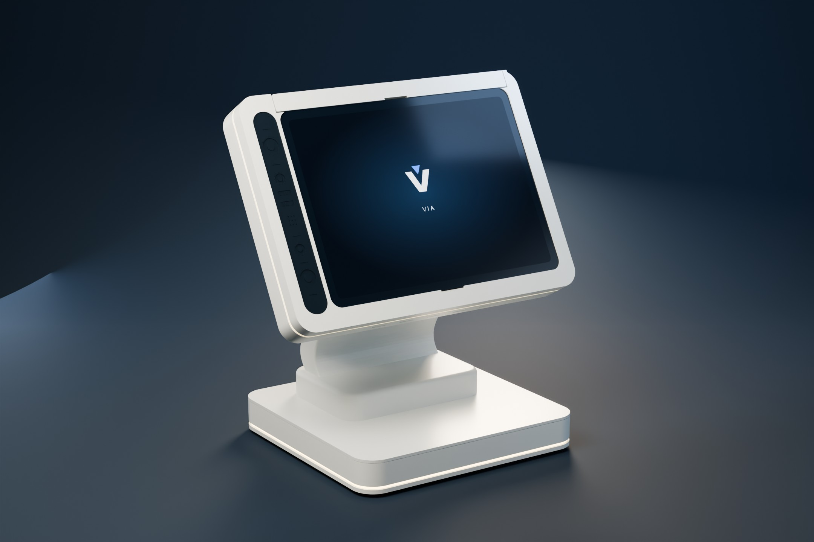
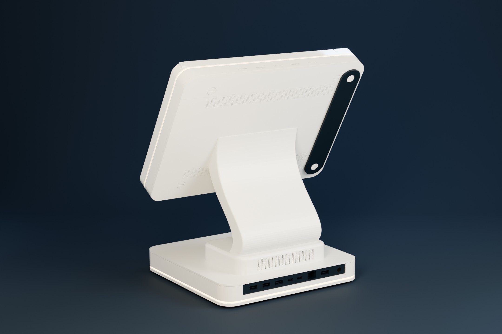
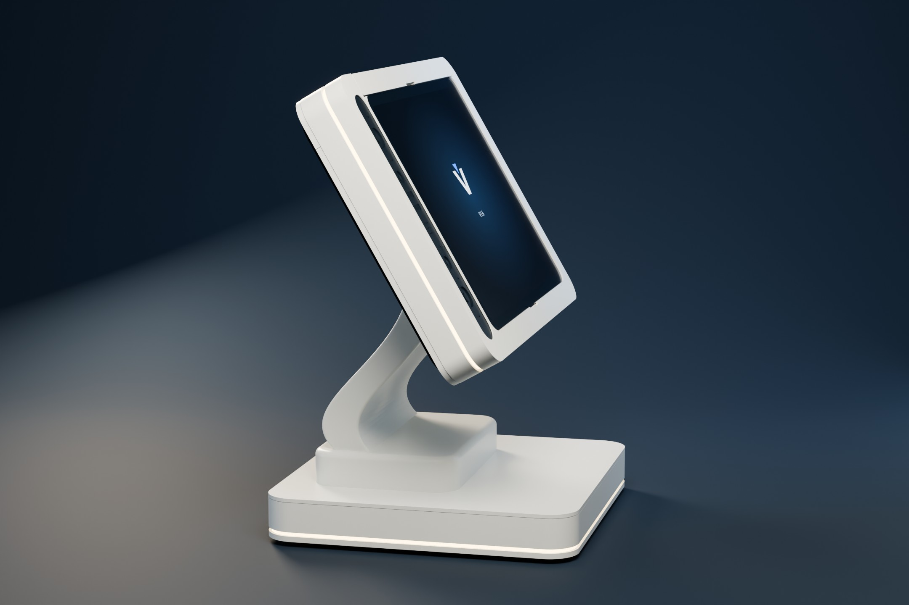
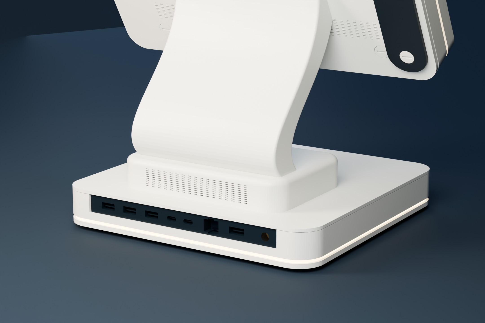

# VIA — Product Presentation Gallery

Four studio views of the supplied **OnePlus Pad OPD2203 terminal enclosure**, presented as a complete assembly. The midnight-blue cyclorama, broad soft lights, satin-white finish and warm light belts are a visualization setup. Mechanical CAD and print STLs are unchanged.

The display uses a static VIA brand plate derived from the project's app mark. It is **staged artwork, not a runtime screenshot**. Material transmission and LED appearance illustrate intent; the [engineering figures](gallery.md) and [verification record](verification.md) describe geometry and evidence separately.

## Front three-quarter

[Full-resolution PNG](../media/presentation/01-front-hero.png)

## Rear architecture

[Full-resolution PNG](../media/presentation/02-rear-architecture.png)

## Sculpted profile

[Full-resolution PNG](../media/presentation/03-sculpted-profile.png)

## Light and port detail

[Full-resolution PNG](../media/presentation/04-light-and-port-detail.png)

## Download and edit the presentation

[Download the full-resolution images and editable Blender studio](https://github.com/vluncasu/via-oneplus-pad-terminal/releases/download/r14.1-cad.3/VIA_Presentation_Studio_R14_1.zip). The studio is supplied as an assembled `.blend` scene with its display texture packed. Change cameras, lights and materials directly in Blender.

JPEGs are used on the GitHub landing page for faster loading; PNG masters retain the full rendered resolution.
